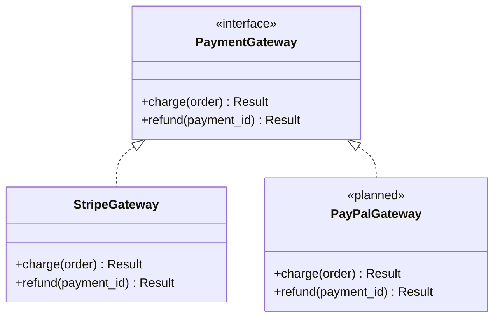
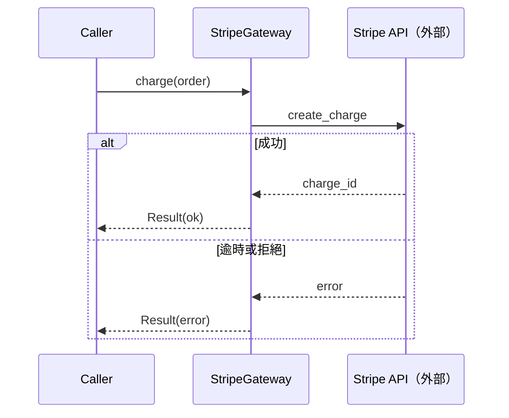

# Diagram 驅動寫 code

目標：令 AI 改 code 時只郁到目標元件，人睇得明、維護得到，而且錯咗可以整個 class 換走。

適用：中型以上、AI 會長期參與維護嘅項目。細 script 或一次性項目唔使用。

## 一、核心做法

### 1. Folder 結構
- 按「元件」分 folder，唔係一個 helper 一個 folder，亦唔開投機性嘅 folder。
- 每個元件 folder 放：對外 interface、實作 class、private helper（`_helpers/` 或 folder 內私有函式）、一份 `ARCHITECTURE.md`。
- 其他 folder 只可以使用呢個元件嘅 interface，唔可以 import 佢嘅 private helper。
- **ARCHITECTURE.md 階層**：
  - **Root**：元件地圖。列出每個元件做咩、對外 interface 喺邊、依賴方向，加跨元件嘅 sequence diagram。唔畫任何 class 內部。
  - **元件 folder**：各自一份，畫自己嘅 class diagram、職責表、sequence diagram。
  - **子元件（sub-folder）**：符合下面「幾時先開 interface」條件先獨立成元件，自己一份文件。喺父元件嘅圖入面只係一個參與者，並連去子元件自己嘅文件，唔好展開，亦唔好重複。
  - 每一層只寫自己嗰層，改動範圍細，被改嘅文件就少。深度建議最多兩至三層，再深通常代表職責切得太碎。
- 檔名 `ARCHITECTURE.md` 可以按項目習慣改名。
- 做改動前，先讀目標元件嘅 `ARCHITECTURE.md` 同 interface，再按需要讀相關實作、測試同 caller，唔好掃描整個 codebase。舊 repo 冇圖時，用呢個範圍建立第一份圖。

### 2. 幾時先開 interface
符合以下其一先開：
1. 被其他 folder 使用（跨邊界）。
2. 預期有多個實作，或者之後可能要換。
3. 依賴外部系統（資料庫、第三方 API、LLM）。

唔使開：
- Folder 內部嘅 class 同 private helper，由 folder 嘅 interface 統一對外，內部可以隨便改。
- 只有一個實作、冇跨邊界、冇外部依賴嘅 class。
- 純資料唔另包 class，但 dict 嘅形狀要用 `TypedDict` 命名（見第 4 點），唔好用匿名 dict。Class 一定要有具體嘅行為職責。

多個實作共用同一個 interface 時，保持 interface 細而專注。方法愈加愈多通常代表職責太雜，應該拆 folder，而唔係撐大 interface。

**DIP 要做，但唔好令 interface 變亂（YAGNI）**
- 實作 class 嘅 constructor 可以接收 interface 型別嘅依賴（DIP），但呢啲參數只係元件內部嘅事，唔係對外 interface 嘅一部分。
- **組裝放喺元件嘅 `__init__.py`**：用一個工廠函式（例如 `default_pricer()`）將實作同佢嘅依賴接埋一齊。對外只匯出 interface、`TypedDict` 同工廠函式；實作 class 唔匯出，咁其他 folder 見唔到 constructor，亦唔會自己組裝。
- Interface 同其他 folder 睇到嘅函式簽名，唔好因為 DIP 而多出一堆參數。
- 冇 interface 嘅內部細 class（驗證、小計等）由實作自己建立，唔使注入。
- 測試喺元件內部，可以直接用 constructor 注入 fake；但先問：呢個測試係咪測緊對外行為？可以用真實協作者跑得過，就唔使 fake。
- AI 提議為咗「將來可能替換」而新增公開參數或匯出實作 class 時，要講明係邊個具體需求；答唔到就唔加。

### 3. ARCHITECTURE.md 內容
建議章節：用途（做咩／唔做咩）、職責同資料契約、class diagram、class 職責表、sequence diagram、計劃中／未接好嘅部分。

**Class diagram 規則（要簡化）**
- 只畫 public method 同 attribute。
- 唔畫 constructor、private 成員、重複繼承嘅方法、note box。
- 實線（association）只用喺真正儲存咗 reference 嘅地方；虛線表示依賴；實心菱形表示擁有。
- 只畫該元件相關嘅 class／interface。外部 collaborator 當一個命名參與者，唔展開佢內部。

**Sequence diagram 規則**
- 畫該 folder 內 class 之間嘅協作細節，以易讀為先；外部 collaborator 只當一個參與者。
- 涵蓋主要流程，加上關鍵嘅錯誤路徑同空值路徑。
- 未接好嘅邊界要誠實畫出，唔好畫成已經行得通嘅流程。

**計劃同已實作要分開標示**
- 計劃中嘅 class／流程用 `<<planned>>` 或獨立章節標明。
- 規劃圖唔可以畫到好似已經能跑。

**資料契約表（涉及欄位／參數時）**
- 只有一張表，每行一個真實欄位，唔好將多個欄位寫喺同一格。
- 表頭用函式真正嘅參數名。
- 「存在」欄只填 `Yes` 或 `—`；定義、單位、粒度寫喺 definition 欄。
- 只寫 interface 層，private helper 唔使寫，避免同 code 重複。
- 表同 code 入面嘅 `TypedDict` 一一對應：`TypedDict` 係 code 嘅定義，表係畀人睇嘅版本，改一個要喺同一個改動入面同步改另一個。

**Class 職責表**
每個 class 一行，職責逐點列出（一點一個責任），並分開列出「不負責」嘅嘢。

### 4. 資料型別同 docstring（必須）

**資料型別**
- 凡係形狀穩定、會跨函式或跨 folder 傳遞嘅 dict，一律用 `TypedDict` 命名，每個欄位都有型別。簽名唔好寫 `dict`、`list[dict]` 或匿名 tuple。
- 原因：匿名 dict 睇簽名唔知有咩 key，要追入實作先知；回傳 class 要 new、要 import，仲可能藏有 hidden logic，對純資料係 over-architecture。`TypedDict` 純資料、冇行為，簽名即文件，runtime 仍然係普通 dict。
- 字串如果係固定選項，一定用 `Literal`，唔好寫成普通 `str`（例如 `Literal["standard", "vip"]`）。
- Key 係動態嘅 map（例如 `dict[str, int]` 做累加）可以繼續用 `dict[K, V]`，唔使 TypedDict。
- TypedDict 放喺元件自己嘅 `data_types.py`；其他 folder 要用嘅，由元件嘅 `__init__.py` 匯出。
- 唔為咗型別另外包 dataclass 或 class，純資料就係 TypedDict。
- 變數同欄位名帶單位（`amount_pence`、`revenue_gbp`）。
- **DataFrame**：欄位同 dtype 型別表達唔到，所以係資料契約，要寫入契約表（欄位、dtype、單位、可否有 null、多出嘅欄位係咪容許）。欄位清單只定義一次（例如 `data_types.py` 嘅常數），文件表同驗證共用，唔好兩邊各抄一份。跨 folder 嘅函式喺邊界驗證輸入同輸出，內部 private helper 唔使重複驗證。

**Docstring（Google 風格，必須）**
- 範圍：所有 public module、class、method、function、TypedDict 必須有完整 docstring。private helper 至少一行摘要。測試靠描述性嘅名，docstring 可選。
- 語言隨項目，但章節標題固定用英文 `Args:`、`Returns:`、`Raises:`、`Attributes:`，工具同 AI 都認得。
- 第一行：一句祈使句摘要（`Return ...`、`Calculate ...`），一行寫完。
- `Args:` 每個參數一行：`名稱: 意思，單位，範圍`。
- `Returns:` 講返回咩、單位、保證（例如排序、唔超過某值）。返回 TypedDict 時，欄位意思寫喺 TypedDict 嘅 `Attributes:`，唔好喺度重複。
- `Raises:` 每種例外同觸發條件；冇就唔寫呢節。
- 有副作用或不變量先加 `Note:`（例如「唔會改動傳入嘅 order」）。
- Class docstring：一句職責，加 `Not responsible for:`，要同 `ARCHITECTURE.md` 嘅職責表一致。
- TypedDict docstring：一句說明，加 `Attributes:` 逐欄位寫意思、單位、範圍。

標準範本：

```python
class OrderItem(TypedDict):
    """One line of an order.

    Attributes:
        sku: Product identifier, non-empty.
        unit_price_pence: Price of one unit in pence, at least 0.
        quantity: Number of units, at least 1.
    """

    sku: str
    unit_price_pence: int
    quantity: int


class DiscountPolicy:
    """Decide the discount for an order subtotal.

    Not responsible for: tax, validation.
    """

    def discount(self, subtotal_pence: int, customer_tier: CustomerTier) -> int:
        """Return the discount for a subtotal.

        Args:
            subtotal_pence: Order subtotal in pence, at least 0.
            customer_tier: Customer tier. "vip" adds 5% on top of the base rate.

        Returns:
            Discount in pence, never more than the subtotal.
        """
```

### 5. 改動流程（每個小改動）
1. **快速確認**：需求清楚、冇牽涉受保護契約，就直接做。只有阻擋性問題未回答、輸入輸出意思未對齊、或者範圍未獲授權時，先停低問。涉及業務語義嘅改動，先同用戶對齊驗收例子。未確認前，可以先做文件同唯讀分析。
2. **先改 diagram**：改動涉及 interface、資料契約、跨元件依賴、主要流程或 class 職責時，先更新 `ARCHITECTURE.md`。
3. **講最小設計**，然後 TDD：寫一個會失敗嘅 test → 實作 → refactor。
4. 跑針對性 test 同合適嘅回歸 test；檢查 diff；檢查 Mermaid 可以解析；檢查 diagram 同 code 一致；檢查新增或修改嘅 public 項目都有齊 docstring，dict 形狀都用 TypedDict。
5. **誠實匯報**（見第 9 點）。
6. 達到驗收條件先標 DONE。有個 stub 唔等於整個功能完成。

唔影響 interface、資料契約、職責或 class 協作嘅改動（typo、private helper 內部重構、log 文字）可以唔改 diagram，但 test 仍然要過。

### 6. 測試規則：測對外承諾，唔測內部結構
- 測對外可觀察嘅承諾：業務同數值行為、安全同完整性、計數語義、冇重複、輸入唔被改動、真實失敗情況，以及下游真正依賴嘅資料格式同語義（例如輸出一定有某欄位、金額單位係英鎊）。
- **判斷標準**：呢個斷言失敗時，下游會唔會壞？會，就係行為，要測。只有重構先會令佢失敗，就係結構，禁止。
- **禁止結構測試**：內部欄位排列、signature、import、type identity、宣告形狀，以及純粹為咗 coverage 而寫嘅 test。結構上嘅保護靠 diagram、批准流程同依賴檢查，唔靠 test。
- 被要求刪走嘅結構測試，唔可以換個名搬去其他 PR。
- **Contract test** 只接受行為層面：同一套行為場景套用喺同一 interface 嘅所有實作，咁錯咗先可以整個 class 換走而唔使改 test。
- 純可讀性／型別 refactor：先記錄一個通過嘅行為基線，refactor 後重跑同一批 test。唔好為咗有 RED 而捏造失敗。

反例（點解有呢條規則）：AI 曾經寫咗 20 個 schema／signature／import 測試，coverage 數字好靚，但全部只係檢查內部結構，製造咗虛假安全感。後來全部刪除。

### 7. 改 interface 要經人批准
**受保護契約**：用戶指定要事先批准嘅 interface 改動類別。可供選擇：
- 改 public 方法簽名（參數、回傳、型別、可否 null、錯誤行為）
- 刪除或改名 interface 方法
- 改 class 職責
- 新增跨 folder 依賴
- 改資料結構（欄位、schema、單位、語義）
- 改或刪 contract test

**每次遇到 interface 改動，主動做兩件事：**
1. **估算影響範圍**：搜尋同閱讀 code，估算呢個 interface 仲有冇被「同當前工作無關」嘅其他 code 使用（其他 folder 嘅 caller、其他元件、下游報表、外部使用者），列出你搵到嘅。
2. **主動問用戶**：連同估算結果，問「呢類 interface 改動，下次需唔需要事先批准？」。如果有無關嘅其他使用者，**建議每次都要批准**；如果只有當前工作用到，可以建議降級，但仍然由用戶決定。將答案記入項目嘅 AI 指引檔（例如 CLAUDE.md 或同類檔案）。已記錄咗答案嘅類別，按答案行，唔使重複問。

未有明確答案時，預設**所有 interface 改動都要批准**。

批准流程：
- 改之前：用用戶睇得明嘅語言報告前後契約對比、原因、受影響嘅使用者（包括無關嘅其他使用者）、相容性、負責人，然後等批准。
- 改完後：報告實際改咗乜同 test 證據。
- AI 唔可以自己批准設計；內部 review 唔代替通知用戶。

### 8. 範圍同擁有權
- 只做獲授權嘅範圍。別人負責嘅設計或實作，只可以提方案，唔可以代改。
- 發現問題時，將問題同建議交畀負責人，唔好自行擴大範圍。

反例：AI 曾經自行加咗一個完整嘅 fallback controller class，後來確認失敗處理應該跟負責人嘅設計，整個 class 被 revert。因為 class 喺獨立 folder 內，撤走只動咗少量 commit，其他元件冇受影響。

### 9. 誠實匯報
- 用四個狀態詞：`NOT RUN`、`BLOCKED`、`FAILED`、`PASSED`，唔好混用。
- 只係計劃咗嘅 RED test，唔可以講成已觀察到。
- 舊測試總數唔可以當作新改動嘅證據。
- 匯報要分清：真實執行、受控結果、fixture、生產環境。

### 10. 接手既有非 OOP 項目：先注入，再逐步搬
舊項目冇元件邊界、冇圖、可能冇測試時，唔好一次過重寫。用 strangler 方式逐塊搬：

1. **搵入口**：搵到核心邏輯嘅入口，向舊 code 注入一個薄 caller（改動最少）。
2. **釘死現有行為**：舊 code 冇測試時，先寫 characterization test 記錄「而家做緊咩」，包括輸出同下游依賴嘅格式。
3. **開新元件 folder**：interface、`TypedDict`、`ARCHITECTURE.md`，只放呢一塊核心邏輯。
4. **新元件過同一批測試**，高風險邏輯可以新舊兩邊都跑，比較結果（shadow run）。
5. **切換 caller**，並保留退返用舊路徑嘅方法（例如開關）。
6. **驗證後刪舊 path**，連 adapter 一齊刪，再搬下一塊。

**幾時先值得搬**：符合其中幾項先搬：核心邏輯大、經常改、AI 成日改壞、輸入輸出邊界清楚。細 script、膠水 code、純函式唔使硬轉 OOP；純函式加 `TypedDict` 已經足夠，class 一定要有行為職責。

**注入 caller 要薄**：
- 只做兩件事：將舊資料轉成新元件嘅 `TypedDict`，然後呼叫新 interface。唔放任何業務邏輯。
- 放喺舊 code 一側（例如 `legacy_adapter`），方便日後一齊刪走。
- 注入 caller 等於新增跨 folder 依賴，按第 7 點預設要批准。

**文件**：新元件有自己嘅 `ARCHITECTURE.md`。舊 code 喺 root 圖同 sequence diagram 只畫成一個 `<<legacy>>` 參與者，唔展開；每次只搬一塊，唔好一次過畫晒成個舊系統。

## 二、進階（可選，未必每個項目都需要）

### A. 強制機制
以上規則預設係 AI 要跟嘅指引。如果發現規則會被漏（文件有寫但 AI 仍然跳過），可以加自動檢查：
- 依賴檢查：跨 folder 只准 import interface（Python：import-linter；TS：dependency-cruiser；Java：ArchUnit）。
- Pre-commit 或 CI：改咗 interface 檔案但冇改 `ARCHITECTURE.md` 就失敗。
- 改 interface 檔案時要求批准標記。
- 型別同 docstring 檢查：型別用 mypy 或 pyright，docstring 用 ruff 嘅 `D` 規則（Google convention）。
- DataFrame 欄位驗證：邊界函式至少檢查必需欄位存在；建議用 `pandera`（或自己寫 decorator）連 dtype、null、數值範圍一齊檢查。留意每次呼叫都驗證有成本，只放喺 interface 邊界，必要時可喺 production 關閉。
- 實作簽名一致：實作簽名（參數名、順序、kind、型別、return）要同 interface 完全一致，用型別檢查器強制。Python 用 pyright（`reportIncompatibleMethodOverride`）或 mypy，TypeScript 用 `tsc --strict`，Java／C# 編譯器本身會擋。唔好為咗呢點自己寫 runtime 檢查放入 skill。

### B. Commit hash 對應
喺 `ARCHITECTURE.md` 記錄 diagram 同 implementation 對應嘅 commit。注意 commit 唔可以包含自己嘅 hash，所以記錄嘅係上一個 commit。較穩陣嘅做法係用 script 偵測：比較 `git log -1 --format=%H -- <diagram>` 同 code 最後改動嘅 commit，而唔係手寫 hash。

### C. Test plan 同 notebook（只限重要 class）
- 只有重要嘅 class（核心邏輯、資料入口）先需要 test plan。
- Test plan 由 diagram 同 interface 推導：每個方法嘅正常、邊界、錯誤情況，由人確認「測乜」，然後先寫 test。
- Notebook 由 test plan 生成，畀人試玩同確認行為，**只係本地即棄物，唔入 git，壞咗先再生，唔維護**。
- 試玩時發現有用嘅 case，要升級返去 test plan 同 test，唔好留喺 notebook。
- Notebook 唔好放喺以 `.` 開頭嘅 folder（Jupyter 唔支援隱藏路徑，網址打唔開）。
- 除非用戶要求，唔好自行執行 notebook。

### D. 分級批准
當用戶累積咗經驗，可以將 interface 改動分級：自動（typo、private helper、不影響 interface）、事後通知（向後兼容嘅新增，而且冇無關嘅其他使用者）、必須批准（見上面清單）。由嚴開始，睇邊類批准次次都通過，再逐步放鬆。分級由用戶決定。

## 三、ARCHITECTURE.md 模板

````markdown
# <元件名>

> 一至三行：呢個元件做咩、唔做咩。

## 職責與資料契約
- 輸入：…
- 輸出：…
- 明確唔負責：…

| 欄位 | `param_name` | 輸出 | 定義 |
| --- | --- | --- | --- |
| `field_a` | Yes | — | 定義、單位、粒度 |

## Class diagram


## Class 職責
| Class | 職責 | 不負責 |
| --- | --- | --- |
| `StripeGateway` | <ul><li>將訂單轉成 Stripe 請求</li><li>處理 Stripe 回應同錯誤</li></ul> | 重試策略、訂單狀態 |

## Sequence diagram


## 未接好／計劃中
- [計劃] PayPalGateway 尚未實作。
````

## 四、Folder 結構範例

```
payment/
  ARCHITECTURE.md
  payment_gateway.py      # 共用 interface
  stripe_gateway.py       # 實作
  paypal_gateway.py       # 實作（計劃中）
  _helpers/               # private，外面唔准 import
  tests/
    test_gateway_contract.py   # 行為 contract test，套用喺所有實作
```

## 五、唔屬於呢個 skill
角色分工、PM 流程、commit 內容限制、命名風格、環境同容器規則等，屬於個別項目或團隊嘅規範，唔放喺呢度。
