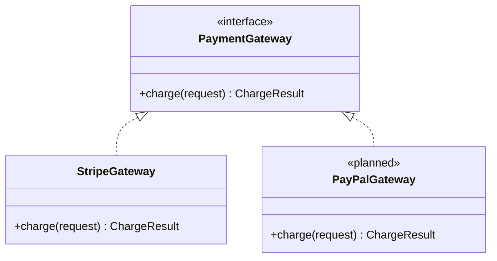
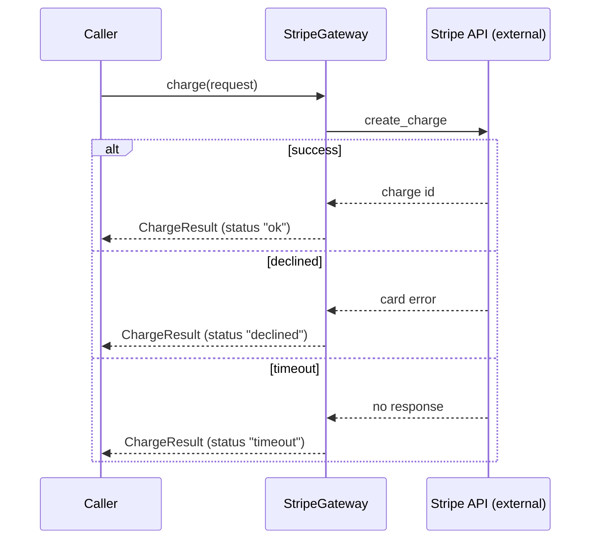

# Diagram-driven coding

Goal, in two parts. **Readable**: AI-written code is not a black box; a human reads it top-down through layered diagrams (root map, then component, then sub-component, then code) and can check whether the design makes sense. **Contained**: when an AI changes code it touches only the target component, and a class that turns out wrong can be replaced as a whole. The first only holds while diagrams match the code, so keep them in sync.

Use it for medium or larger projects that an AI will help maintain over time. Skip it for small scripts and one-off work.

Examples are in Python. The principles apply to any language; see "Other languages" at the end for the mapping.

## Quick checklist (every change)

1. **Read narrowly.** Read the target component's `ARCHITECTURE.md` and interface, then only the implementation, tests and callers you need. Do not scan the whole codebase. If the diagram and the code disagree, the code is right: correct the diagram before relying on it, and say that you did.
2. **Interface change?** Find who else uses it and get approval first (section 7). This is the one step where a repo-wide search for callers is expected.
3. **Diagram first.** If the change touches an interface, a data contract, a cross-component dependency, a main flow or a class responsibility, update `ARCHITECTURE.md` before the code.
4. **TDD.** Write a failing behaviour test, implement, refactor (section 6).
5. **Verify.** Run the tests, read the diff, check the diagram against the code, check docstrings and data types (section 5).
6. **Report honestly** with `NOT RUN`, `BLOCKED`, `FAILED` or `PASSED` (section 9).

The numbered sections below explain each step. Part 2 is optional.

## Part 1. Core practice

### 1. Folder structure

- One folder per component. Not one folder per helper, and no speculative folders.
- A component folder holds its public interface, its implementation classes, its private helpers (`_helpers/` or private functions) and one `ARCHITECTURE.md`.
- Other folders use only what the component exports. They never import its private helpers or implementation modules.

```
payment/
  ARCHITECTURE.md
  __init__.py             # the export surface: interface, data types, factory
  interface.py            # PaymentGateway
  data_types.py           # ChargeRequest, ChargeResult
  stripe_gateway.py       # implementation
  paypal_gateway.py       # implementation (planned)
  _helpers/               # private; nothing outside imports this
  tests/
    test_gateway_contract.py   # behaviour contract tests, run against every implementation
```

**Layers of `ARCHITECTURE.md`**

- **Root**: the component map. For each component: what it does, where its public interface is, and which way dependencies point, plus sequence diagrams for flows that cross components. No class internals.
- **Component folder**: one file each, with its own class diagram, responsibility table and sequence diagrams.
- **Sub-component (sub-folder)**: becomes its own component, with its own file, only when it meets the conditions in section 2. In the parent's diagrams it is a single participant that links to the sub-component's file. Do not expand it and do not repeat it.
- Each layer describes only itself, so a change touches few documents. Keep depth to two or three layers; deeper usually means responsibilities are cut too finely.
- The file name `ARCHITECTURE.md` may follow the project's own convention.
- In an old repo with no diagrams, use the narrow reading scope from the checklist to write the first one.

### 2. When to add an interface

Add one only when at least one of these holds:

1. It is used from another folder (it crosses a boundary).
2. Several implementations exist, or a replacement is expected.
3. It depends on an external system (database, third-party API, LLM).

Do not add one for:

- Classes and private helpers inside a folder. The folder's interface is the single public face; the inside may change freely.
- A class with one implementation, no boundary crossing and no external dependency.
- Pure data. Data does not get a class; name its shape with a `TypedDict` (section 4). A class must have a behavioural responsibility.

When several implementations share an interface, keep it small and focused. A growing method list usually means mixed responsibilities: split the folder rather than widen the interface.

**Dependency inversion without clutter (YAGNI)**

- An implementation's constructor may take dependencies typed by interface. Those parameters are internal to the component, not part of its public interface.
- **Wire inside the component's `__init__.py`**: a factory function (for example `default_pricer()`) connects the implementation to its dependencies. Export only the interface, the data types and the factory. Leave implementation classes out of `__all__`; other folders use the factory and the interface and do not assemble anything themselves. Python's `__all__` does not stop a direct import of the implementation module. To enforce it, use a dependency check (Advanced A) or give the module a private name such as `_standard_pricer.py`.
- **Wiring across components**: a factory may wire its own sub-components. To use a different component, the simple default is to call that component's exported factory; the dependency must appear in the root map. Move the wiring up to the application entry point, and take the other component's interface as a parameter, when any of these holds: the dependency reaches an external system, tests need to swap it, or two components must share one instance.
- Public signatures must not grow extra parameters because of dependency inversion.
- Small internal classes with no interface (validation, subtotals) are created by the implementation itself. Do not inject them.
- Tests live inside the component and may inject fakes through the constructor. Ask first whether the test is about public behaviour; if it passes with the real collaborators, do not use a fake.
- When you want to add a public parameter or export an implementation class "in case it needs replacing later", name the concrete need. If you cannot, do not add it.

### 3. What goes in ARCHITECTURE.md

Sections: purpose (does and does not do), responsibilities and data contract, class diagram, class responsibility table, sequence diagram, planned or not-yet-wired parts. The template is in Part 3.

**Class diagram (keep it simple)**

- Public methods and attributes only.
- No constructors, private members, repeated inherited methods or note boxes.
- A solid line (association) only where a reference is actually stored; a dashed line for a dependency; a filled diamond for ownership.
- Only the classes and interfaces of this component. An external collaborator is one named participant; do not expand its internals.

**Sequence diagram**

- Show how the classes inside this folder work together, in whatever form reads most easily. External collaborators are single participants.
- Cover the main flow plus the key error paths and empty-value paths.
- Draw a boundary that is not wired yet as not wired. Do not draw a flow that does not run as if it does.

**Planned versus implemented**

- Mark planned classes and flows with `<<planned>>` or put them in their own section.
- A planning diagram must never look like working code.

**Data contract table (when fields or parameters are involved)**

- One table. One row per real field. Never several fields in one cell.
- Columns: `Field`, then one column per real parameter that carries data, headed with the parameter's actual name, then `Output`, then `Definition`.
- The parameter and `Output` cells contain only `Yes` or `—`, saying whether the field is present there. Meaning, unit and granularity go in `Definition`.
- Interface level only. Do not document private helpers; that repeats the code.
- **Source of truth**: the `TypedDict` and its docstring define the contract. The table is the reader's summary of it. Change both in the same change; if they ever disagree, the code is right and the table is the bug.

**Class responsibility table**

One row per class. List responsibilities one per bullet, and list what the class is not responsible for in a separate column.

### 4. Data types and docstrings (required)

**Data types**

- Any dict with a stable shape that passes between functions or folders is a named `TypedDict` with a type on every field. Signatures do not say `dict`, `list[dict]` or an anonymous tuple.
- Why: an anonymous dict hides its keys until you read the implementation. A returned class has to be constructed and imported and can hide logic, which is over-architecture for pure data. A `TypedDict` is pure data with no behaviour, the signature documents itself, and at runtime it is still a plain dict.
- A string with a fixed set of values is a `Literal`, never a plain `str` (for example `Literal["standard", "vip"]`).
- A map with dynamic keys (for example `dict[str, int]` used as a counter) stays `dict[K, V]`.
- `TypedDict`s live in the component's own `data_types.py`. Those that other folders need are exported from `__init__.py`.
- Do not wrap data in a dataclass or class just to get a type. A value that must enforce a rule of its own (for example money that refuses to mix currencies) has behaviour, so it is a class, not pure data.
- Put the unit in variable and field names (`amount_pence`, `revenue_gbp`).
- **Untrusted input**: a `TypedDict` is checked statically, not at runtime. Data that arrives from outside the program (an HTTP body, a file, an LLM response) is validated once at the boundary where it enters, and passed on as a `TypedDict` only after that. Inner code does not validate it again.
- **DataFrames**: types cannot express columns and dtypes, so they are a data contract and go in the contract table (column, dtype, unit, nullable, whether extra columns are allowed). Define the column list once (for example a constant in `data_types.py`) and let both the document and the validation use it. Functions that cross folders validate their input and output at the boundary; private helpers do not repeat it.

**Docstrings (Google style)**

- Every public module, class, method, function and `TypedDict` has a full docstring. A private helper has at least a one-line summary. Tests rely on descriptive names; docstrings are optional there.
- Write in the project's language, but keep the section headings in English (`Args:`, `Returns:`, `Raises:`, `Attributes:`) so tools and AIs recognise them.
- First line: one imperative sentence (`Return ...`, `Calculate ...`) on one line.
- `Args:` one line per parameter: `name: meaning, unit, range`.
- `Returns:` what comes back, its unit and its guarantees (for example sorted, never above some value). When the return type is a `TypedDict`, the field meanings live in its `Attributes:`; do not repeat them.
- `Raises:` each exception and what triggers it. Omit the section when there are none.
- `Note:` only for side effects or invariants (for example "does not modify `order`").
- Class docstring: one sentence of responsibility plus `Not responsible for:`, matching the responsibility table in `ARCHITECTURE.md`.
- `TypedDict` docstring: one sentence plus `Attributes:` with meaning, unit and range per field.

Reference example:

```python
CustomerTier = Literal["standard", "vip"]


class OrderItem(TypedDict):
    """One line of an order.

    Attributes:
        sku: Product identifier, non-empty.
        unit_price_pence: Price of one unit in pence, at least 0.
        quantity: Number of units, at least 1.
    """

    sku: str
    unit_price_pence: int
    quantity: int


class DiscountPolicy:
    """Decide the discount for an order subtotal.

    Not responsible for: tax, validation.
    """

    def discount(self, subtotal_pence: int, customer_tier: CustomerTier) -> int:
        """Return the discount for a subtotal.

        Args:
            subtotal_pence: Order subtotal in pence, at least 0.
            customer_tier: Customer tier. "vip" adds 5% on top of the base rate.

        Returns:
            Discount in pence, never more than the subtotal.
        """
```

### 5. Change workflow (every small change)

1. **Confirm quickly.** If the request is clear and no protected contract is involved, start. Stop and ask only when a blocking question is unanswered, the meaning of an input or output is not agreed, or the scope is not authorised. For a change in business meaning, agree acceptance examples with the user first. Documentation and read-only analysis may go ahead before confirmation.
2. **Diagram first.** If the change touches an interface, a data contract, a cross-component dependency, a main flow or a class responsibility, update `ARCHITECTURE.md` first.
3. **State the smallest design**, then TDD: failing test, implementation, refactor.
4. **Verify**, and say which checks actually ran:
   - Targeted tests and the relevant regression tests.
   - The diff contains only what the change needs.
   - Diagram against code, in both directions: every class and public method in the diagram exists in the code under the same name, and every public class and method in the component's code is in the diagram. List any mismatch.
   - Mermaid blocks parse. Use a renderer if one is available (for example `mmdc`, or the project's documentation build). If none is, re-read the block for syntax and report the parse check as `NOT RUN`.
   - Every new or changed public item has its docstring, and every dict shape is a `TypedDict`.
5. **Report honestly** (section 9).
6. Mark DONE only when the acceptance conditions are met. A stub is not a finished feature.

A change that does not affect an interface, a data contract, a responsibility or how classes work together (a typo, a refactor inside a private helper, a log message) does not need a diagram update. The tests must still pass.

### 6. Tests: test public promises, not internal structure

- Test promises that are observable from outside: business and numeric behaviour, safety and integrity, counting semantics, no duplicates, inputs left unmodified, real failure cases, and the data formats and meanings that downstream code actually depends on (for example an output always has a given field, or an amount is in pounds).
- **The deciding question**: if this assertion fails, does something downstream break? If yes, it is behaviour: test it. If only a refactor could make it fail, it is structure: do not write it.
- **No tests that pin internal structure**: internal field order, private members, type identity, the shape of declarations, or tests written only for coverage. Structure is protected by the diagram, the approval flow and dependency checks, not by tests.
- **Public compatibility may be tested**: an import path, a keyword argument name or a return format that downstream code really depends on is itself a contract. The same question applies: if it fails, downstream breaks, so it is behaviour.
- A structural test that was rejected must not come back under another name in another PR.
- **Contract tests** are behavioural only: one set of behaviour scenarios runs against every implementation of an interface. That is what lets a wrong class be replaced as a whole without touching the tests.
- For a pure readability or typing refactor, record a passing behaviour baseline first and re-run the same tests afterwards. Do not invent a failure just to have a RED step.

Why this rule exists: an AI once wrote 20 tests on schemas, signatures and imports that nothing downstream relied on. Coverage looked excellent, every test checked internal structure only, and the result was false confidence. All 20 were deleted.

### 7. Interface changes need human approval

**Protected contracts** are the kinds of interface change the user wants to approve in advance. The options:

- Changing a public method signature (parameters, return, types, nullability, error behaviour)
- Removing or renaming an interface method
- Changing a class's responsibility
- Adding a cross-folder dependency
- Changing a data structure (fields, schema, units, meaning)
- Changing or deleting a contract test

**For every interface change, do two things unprompted:**

1. **Estimate the blast radius.** Search and read the code to find whether the interface is used by code unrelated to the current work: callers in other folders, other components, downstream reports, external users. List what you find.
2. **Ask the user.** With that list, ask: "Should this kind of interface change need approval in advance next time?" If unrelated users exist, **recommend approval every time**. If only the current work uses it, you may recommend relaxing it; the user decides. Record the answer in the project's AI instruction file (for example `CLAUDE.md` or `AGENTS.md`). For a kind that already has a recorded answer, follow it and do not ask again.

Until there is a clear answer, **every interface change needs approval**. The one exception is an interface created in the current task that no other code uses yet: it is still being designed, so shaping it is part of the task. It becomes protected once other code depends on it.

The approval flow:

- Before the change: report, in terms the user can follow, the contract before and after, the reason, the affected users (including unrelated ones), compatibility and the owner. Then wait.
- After the change: report what actually changed and the test evidence.
- An AI cannot approve its own design. An internal review does not replace telling the user.

### 8. Scope and ownership

- Do only what is authorised. The owner of a component is the user unless the project says otherwise. For design or code that someone else owns, propose; do not change it.
- When you find a problem outside your scope, hand the problem and a suggestion to the owner. Do not widen the scope yourself.

Why this rule exists: an AI once added a complete fallback controller class on its own initiative. Failure handling turned out to belong to the owner's design, and the whole class was reverted. Because the class sat in its own folder, the revert touched a few commits and no other component.

### 9. Honest reporting

- Use four status words and do not blur them: `NOT RUN`, `BLOCKED`, `FAILED`, `PASSED`.
- A RED test that was only planned was not observed. Do not report it as observed.
- An old test total is not evidence for a new change.
- Say which kind of evidence each result is: a real run, a controlled result, a fixture, or production.

### 10. Taking over existing non-OOP code: inject first, then move piece by piece

When an old project has no component boundaries, no diagrams and possibly no tests, do not rewrite it in one go. Move it piece by piece (strangler pattern):

1. **Find the entry point** of the core logic and inject a thin caller into the old code, changing as little as possible.
2. **Pin the current behaviour.** If the old code has no tests, write characterization tests that record what it does now, including outputs and the formats downstream code depends on.
3. **Create the new component folder**: interface, `TypedDict`s and `ARCHITECTURE.md`, holding only this one piece of core logic.
4. **Run the new component against the same tests.** For high-risk logic, run old and new side by side and compare results (shadow run).
5. **Switch the caller**, keeping a way back to the old path (for example a flag).
6. **After verification, delete the old path** and the adapter with it. Then move the next piece.

**When a move is worth it**: when several of these hold. The core logic is large; it changes often; the AI keeps breaking it; its inputs and outputs have clear boundaries. Small scripts, glue code and pure functions do not need to become classes. A pure function with `TypedDict`s is enough.

**Keep the injected caller thin**

- It does two things only: convert the old data into the new component's `TypedDict`, and call the new interface. No business logic.
- It sits on the old code's side (for example `legacy_adapter`) so it can be deleted together with the old code.
- It is a new cross-folder dependency, so by default it needs approval (section 7).

**Documents**: the new component has its own `ARCHITECTURE.md`. In the root map and the sequence diagrams the old code is a single `<<legacy>>` participant, not expanded. Move one piece at a time; do not draw the whole old system at once.

## Part 2. Advanced (optional)

### A. Enforcement

By default the rules above are guidance the AI follows. If a rule keeps being skipped even though it is written down, add an automatic check. Diagrams going stale is the most likely failure, so the second time a diagram is found out of date, propose the pre-commit check below to the user; it is the cheapest one to add.

- **Dependency check**: across folders, only the export surface may be imported (Python: import-linter; TypeScript: dependency-cruiser; Java: ArchUnit).
- **Pre-commit or CI**: fail when an interface file changed and `ARCHITECTURE.md` did not.
- **Approval marker** required when an interface file changes.
- **Diagram rendering**: render every Mermaid block in CI so a broken diagram fails the build.
- **Types and docstrings**: mypy or pyright for types; ruff's `D` rules (Google convention) for docstrings.
- **DataFrame columns**: boundary functions check at least that required columns exist. Prefer `pandera` (or your own decorator) to check dtype, nulls and value ranges too. Validation costs time on every call, so keep it at interface boundaries and allow it to be switched off in production if needed.
- **Signature compatibility**: an implementation's parameter names, order and kinds match the interface. Types follow the type checker's rules: parameters may widen, the return may narrow. Enforce with the type checker: pyright (`reportIncompatibleMethodOverride`) or mypy for Python, `tsc --strict` for TypeScript; the Java and C# compilers already do it. The tools guarantee compatible, not textually identical; identical needs review or a custom check. Do not write your own runtime check for this.

### B. Commit hash mapping

Record in `ARCHITECTURE.md` which commit the diagram and the implementation correspond to. A commit cannot contain its own hash, so the recorded hash is the previous commit. A sturdier approach is a script that compares `git log -1 --format=%H -- <diagram>` with the last commit that touched the code, rather than a hand-written hash.

### C. Test plans and notebooks (important classes only)

- Only important classes (core logic, data entry points) need a test plan.
- Derive the plan from the diagram and the interface: normal, boundary and error cases for each method. A human confirms what to test, and only then are the tests written.
- A notebook is generated from the test plan so a human can try the behaviour. **It is local and disposable: not in git, regenerated when it breaks, never maintained.**
- A useful case found while trying things out is promoted into the test plan and the tests, not left in the notebook.
- Do not put notebooks in a folder whose name starts with `.` (Jupyter does not serve hidden paths, so the URL will not open).
- Do not run a notebook unless the user asks.

### D. Tiered approval

Once the user has some experience, interface changes can be tiered: automatic (typos, private helpers, nothing that affects an interface), notify afterwards (backward-compatible additions with no unrelated users), approval required (the list in section 7). Start strict, watch which kinds are approved every time, and relax those. The user decides the tiers.

## Part 3. ARCHITECTURE.md template

````markdown
# <component name>

> One to three lines: what this component does and does not do.

## Responsibilities and data contract
- Input: `ChargeRequest` (TypedDict).
- Output: `ChargeResult` (TypedDict).
- Errors: …
- Not responsible for: …
- Types are defined in `data_types.py`. The table below summarises them; change both together.

| Field | `request` (input) | Output | Definition |
| --- | --- | --- | --- |
| `order_id` | Yes | — | Order being paid for (str, non-empty) |
| `amount_pence` | Yes | — | Amount to charge in pence (int, at least 1) |
| `status` | — | Yes | `"ok"`, `"declined"` or `"timeout"` |
| `charge_id` | — | Yes | Gateway charge id (str or `None`); `None` unless `status` is `"ok"` |

## Class diagram


## Class responsibilities
| Class | Responsible for | Not responsible for |
| --- | --- | --- |
| `PaymentGateway` | <ul><li>Defines the public contract for charging</li></ul> | Any implementation detail |
| `StripeGateway` | <ul><li>Turns a `ChargeRequest` into a Stripe request</li><li>Maps Stripe responses and errors to a `ChargeResult`</li></ul> | Retry policy, order state |

## Sequence diagram


## Planned / not wired yet
- [planned] `PayPalGateway` is not implemented.
````

## Part 4. Other languages

The principles are the same; only the tools differ.

| Concept | Python | TypeScript | Java / C# |
| --- | --- | --- | --- |
| Interface | `ABC` or `Protocol` | `interface` | `interface` |
| Pure data shape | `TypedDict` | `type` or `interface` with no methods | `record` with no behaviour |
| Fixed string values | `Literal` | string literal union | `enum` |
| Export surface | `__init__.py` and `__all__` | `index.ts` | package-private / `internal` visibility |
| Doc comments | Google-style docstring | TSDoc | Javadoc / XML doc |

"No class for pure data" means no behaviour hidden in data. Where the language's normal data shape is a record or a plain type, use it and keep it free of logic.

## Part 5. Not part of this skill

Role assignment, PM process, commit content rules, naming style, and environment or container rules belong to the individual project or team, not here.
