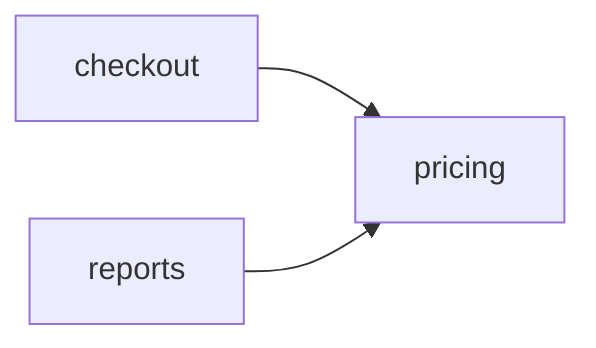
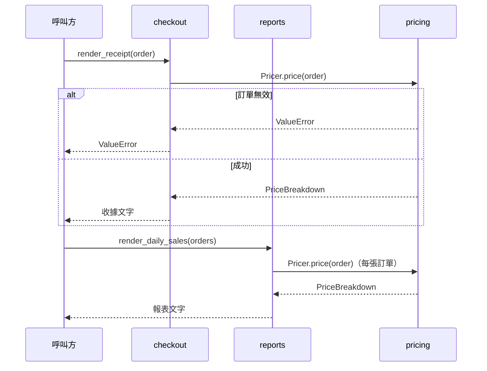

# 示範項目：訂單定價（Root 總覽）

> 呢份係元件地圖：邊個元件做咩、對外 interface 喺邊、誰依賴誰。
> 唔畫任何 class 內部，要睇內部請去各元件自己嘅 `ARCHITECTURE.md`。

## 元件
| 元件 | 做咩 | 對外 interface | 文件 |
| --- | --- | --- | --- |
| `pricing` | 將訂單計成價格明細（小計、折扣、稅、總額） | `Pricer`、`Order`、`PriceBreakdown`、`default_pricer()`（見 `pricing/__init__.py`） | [pricing/ARCHITECTURE.md](pricing/ARCHITECTURE.md) |
| `checkout` | 將訂單印成文字收據 | `render_receipt()` | [checkout/ARCHITECTURE.md](checkout/ARCHITECTURE.md) |
| `reports` | 計算每日銷售總額 | `render_daily_sales()` | [reports/ARCHITECTURE.md](reports/ARCHITECTURE.md) |

`pricing` 入面仲有子元件 `pricing/rules`（折扣同稅），由 `pricing` 自己管理，root 唔需要知道。

## 依賴方向

規則：
- 其他元件只可以用 `pricing/__init__.py` 匯出嘅嘢，唔可以 import `pricing.rules` 或任何內部模組。
- `checkout` 同 `reports` 之間冇依賴。

## 跨元件流程

## 未接好／計劃中
- 暫時冇。
