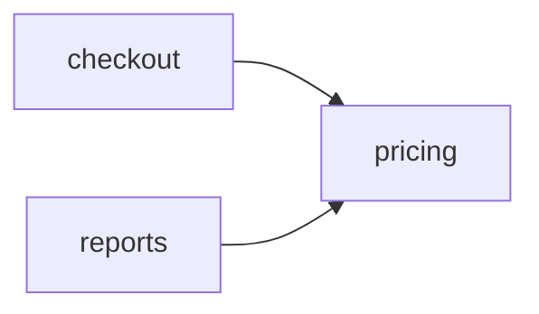
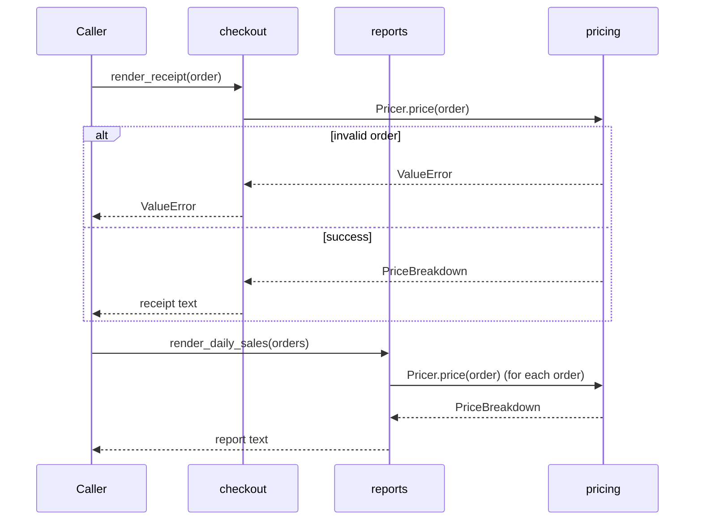

# Demo project: order pricing (root overview)

> This is the component map: what each component does, where its public interface is, and who depends on whom.
> It shows no class internals. For those, read each component's own `ARCHITECTURE.md`.

## Components
| Component | What it does | Public interface | Document |
| --- | --- | --- | --- |
| `pricing` | Prices an order into a breakdown (subtotal, discount, tax, total) | `Pricer`, `Order`, `PriceBreakdown`, `default_pricer()` (see `pricing/__init__.py`) | [pricing/ARCHITECTURE.md](pricing/ARCHITECTURE.md) |
| `checkout` | Renders an order as a text receipt | `render_receipt()` | [checkout/ARCHITECTURE.md](checkout/ARCHITECTURE.md) |
| `reports` | Calculates the daily sales total | `render_daily_sales()` | [reports/ARCHITECTURE.md](reports/ARCHITECTURE.md) |

`pricing` also contains the sub-component `pricing/rules` (discount and tax). `pricing` manages it; the root does not need to know about it.

## Dependency direction

Rules:
- Other components may use only what `pricing/__init__.py` exports. They may not import `pricing.rules` or any internal module.
- `checkout` and `reports` do not depend on each other.

## Cross-component flow

## Planned / not wired yet
- Nothing at the moment.
