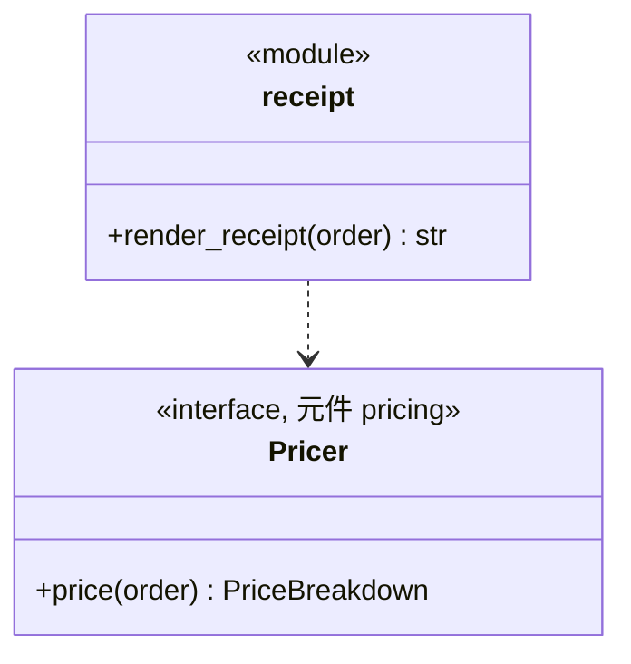
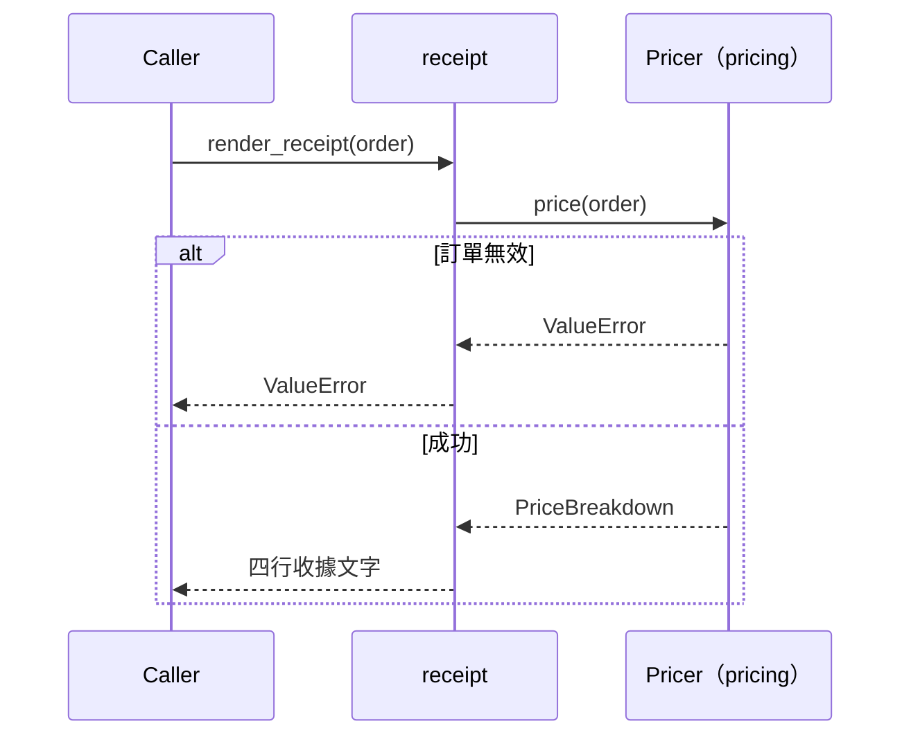

# checkout

> 將一張訂單印成文字收據。
> 唔負責：計價（用 `pricing` 嘅 `Pricer`）、收款、列印。

## 職責與資料契約
- 輸入：`Order`。計價用 `default_pricer()`，唔對外開放替換。
- 輸出：四行文字（`Subtotal`、`Discount`、`VAT`、`Total`），金額以英鎊顯示。
- 錯誤：訂單無效時，`ValueError` 由 `pricing` 直接向上拋。
- 依賴 `pricing` 輸出嘅 `PriceBreakdown` 欄位名同單位（便士）。

| 欄位 | 輸入 | 輸出 | 定義 |
| --- | --- | --- | --- |
| `order` | Yes | — | `pricing.Order` |
| 收據文字 | — | Yes | 四行，每行 `標籤: £金額`，兩位小數 |

## Class diagram

## Class 職責
| 單元 | 職責 | 不負責 |
| --- | --- | --- |
| `receipt`（模組） | <ul><li>呼叫 `Pricer` 取得價格明細</li><li>將便士格式化成英鎊文字</li></ul> | 任何計價規則 |

## Sequence diagram

## 未接好／計劃中
- 暫時冇。
