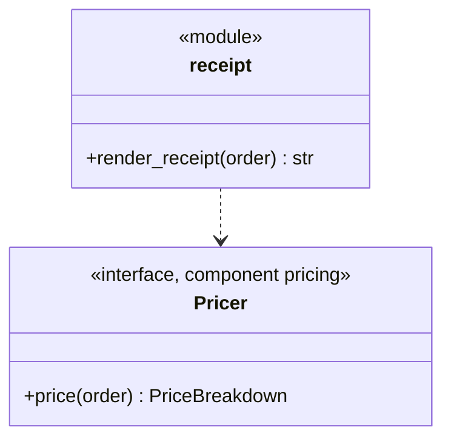
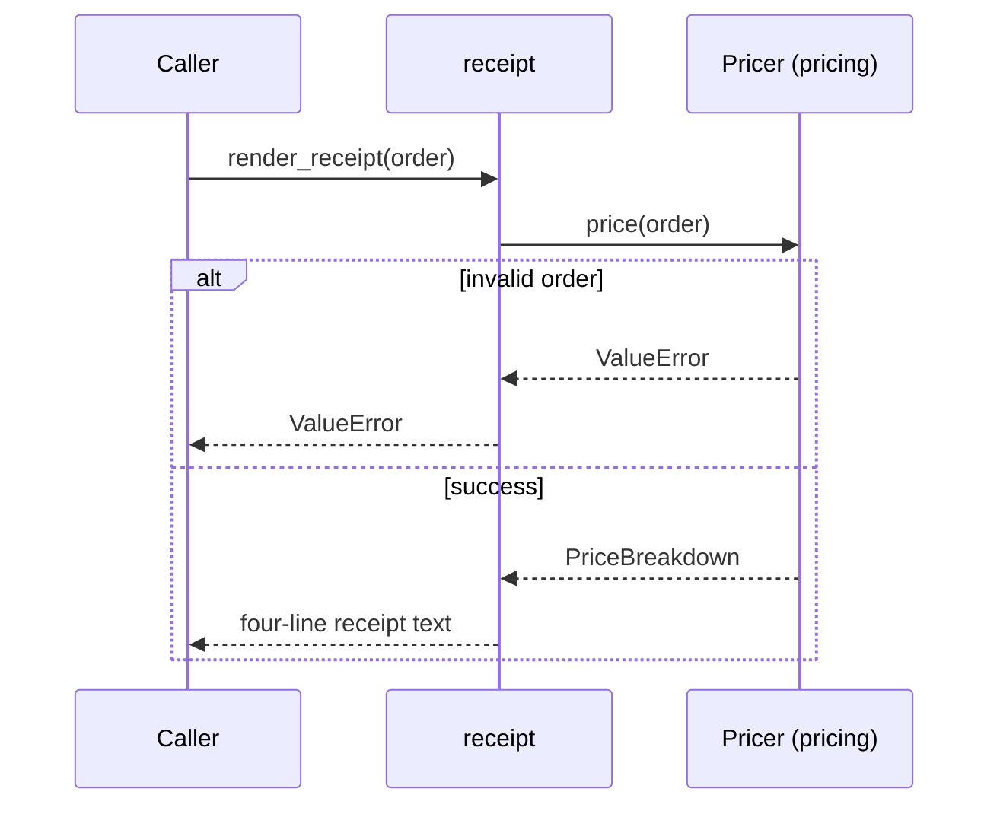

# checkout

> Renders one order as a text receipt.
> Not responsible for: pricing (uses the `Pricer` from `pricing`), taking payment, printing.

## Responsibilities and data contract
- Input: `Order`. Pricing uses `default_pricer()`; replacing it is not offered to callers.
- Output: four lines of text (`Subtotal`, `Discount`, `VAT`, `Total`), amounts shown in pounds.
- Errors: when the order is invalid, the `ValueError` from `pricing` propagates unchanged.
- Depends on the field names and unit (pence) of the `PriceBreakdown` that `pricing` returns.

| Field | Input | Output | Definition |
| --- | --- | --- | --- |
| `order` | Yes | — | `pricing.Order` |
| receipt text | — | Yes | Four lines, each `Label: £amount` with two decimal places |

## Class diagram

## Class responsibilities
| Unit | Responsible for | Not responsible for |
| --- | --- | --- |
| `receipt` (module) | <ul><li>Calls `Pricer` to get the price breakdown</li><li>Formats pence as pounds text</li></ul> | Any pricing rule |

## Sequence diagram

## Planned / not wired yet
- Nothing at the moment.
