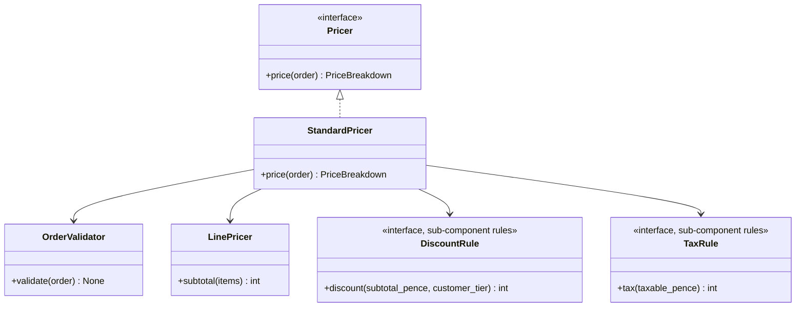
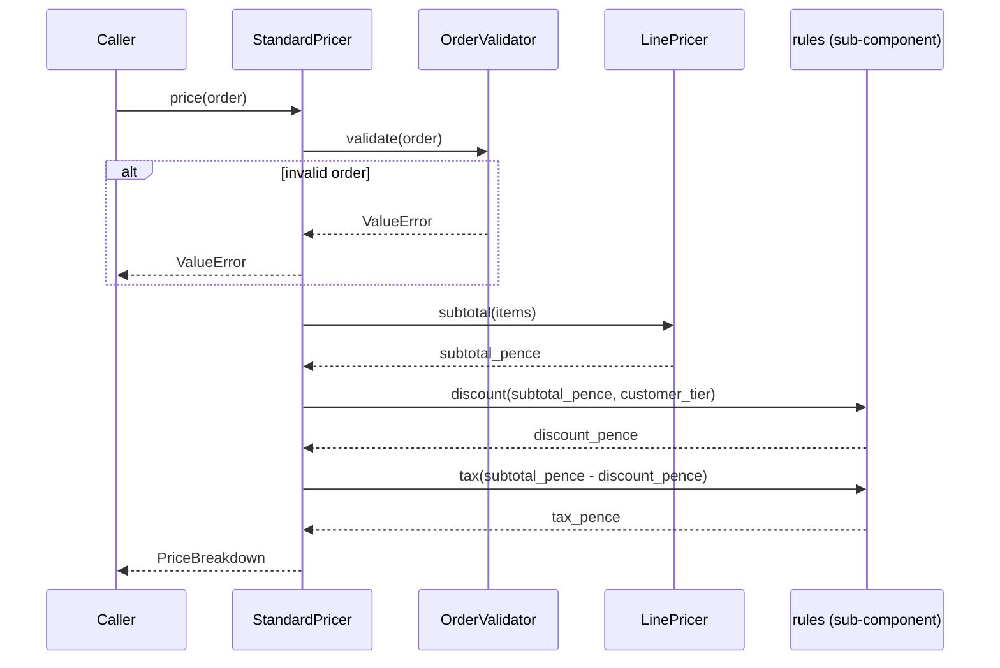

# pricing

> Prices one order into a breakdown (subtotal, discount, tax, total).
> Not responsible for: reading orders, taking payment, report layout, currency conversion (all amounts are pence sterling).
> The discount and tax rules live in the sub-component [`rules/`](rules/ARCHITECTURE.md) and are not repeated here.

## Responsibilities and data contract
- Input: `Order` (TypedDict).
- Output: `PriceBreakdown` (TypedDict). All amounts are integer pence.
- Errors: raises `ValueError` when the order is invalid (no items, a quantity below 1, an unknown `customer_tier` and so on).
- Does not modify the `order` passed in.
- Wiring: `default_pricer()` in `__init__.py` connects `StandardPricer` to `rules`. Only `Pricer`, the types and `default_pricer()` are exported. `StandardPricer` is left out of `__all__` (by convention other folders do not use it directly), so its constructor parameters are not part of the public interface.
- Types are defined in `data_types.py` (`Order`, `OrderItem`, `PriceBreakdown`, `CustomerTier`). The table below summarises them; change both together.

| Field | `order` (input) | Output | Definition |
| --- | --- | --- | --- |
| `customer_tier` | Yes | — | `"standard"` or `"vip"` |
| `items` | Yes | — | Order lines (`OrderItem`); each has `sku` (str), `unit_price_pence` (int, at least 0), `quantity` (int, at least 1) |
| `subtotal_pence` | — | Yes | Sum of unit price times quantity over all items (int) |
| `discount_pence` | — | Yes | Discount amount (int), never more than the subtotal |
| `tax_pence` | — | Yes | Tax on the amount after discount (int) |
| `total_pence` | — | Yes | Subtotal − discount + tax (int) |

## Class diagram

## Class responsibilities
| Class | Responsible for | Not responsible for |
| --- | --- | --- |
| `Pricer` | <ul><li>Defines the public contract for pricing</li></ul> | Any implementation detail |
| `StandardPricer` | <ul><li>Runs validation, subtotal, discount and tax in order</li><li>Assembles the price breakdown</li><li>Its constructor takes the `DiscountRule` and `TaxRule` provided by `rules` (dependency inversion)</li></ul> | Any calculation rule itself |
| `OrderValidator` | <ul><li>Checks the order's shape and value ranges</li><li>Raises `ValueError` when invalid</li></ul> | Pricing |
| `LinePricer` | <ul><li>Sums unit price times quantity over all items</li></ul> | Discount, tax |

The implementations of `DiscountRule` and `TaxRule` (`DiscountPolicy`, `TaxCalculator`) belong to the sub-component; see [rules/ARCHITECTURE.md](rules/ARCHITECTURE.md).

## Sequence diagram

## Planned / not wired yet
- Nothing at the moment.
