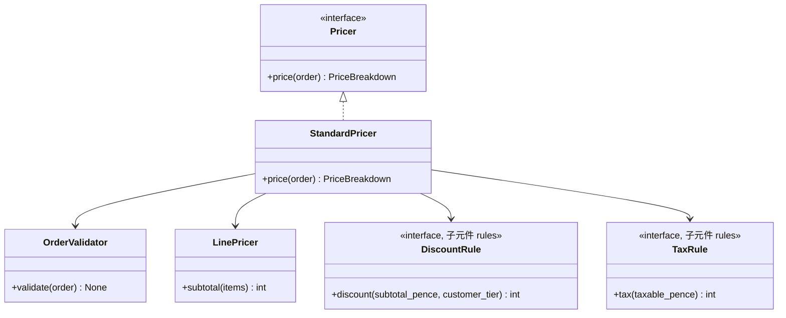
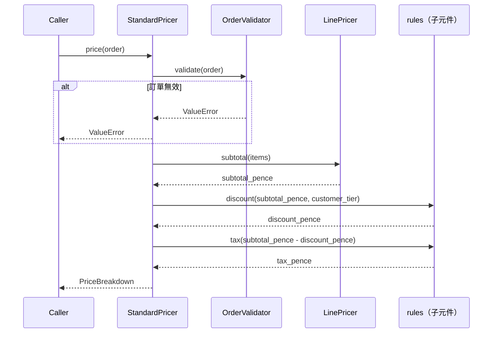

# pricing

> 將一張訂單計成價格明細（小計、折扣、稅、總額）。
> 唔負責：讀取訂單、收款、報表排版、貨幣換算（金額一律係英鎊嘅便士）。
> 折扣同稅嘅規則喺子元件 [`rules/`](rules/ARCHITECTURE.md)，本文件唔重複。

## 職責與資料契約
- 輸入：`Order`（TypedDict）。
- 輸出：`PriceBreakdown`（TypedDict），全部金額係整數便士。
- 錯誤：訂單無效（冇商品、數量細過 1、未知 `customer_tier` 等）時 raise `ValueError`。
- 唔會改動傳入嘅 `order`。
- 組裝：`__init__.py` 嘅 `default_pricer()` 將 `StandardPricer` 同 `rules` 接埋一齊。對外只匯出 `Pricer`、型別同 `default_pricer()`；`StandardPricer` 唔放入 `__all__`（約定其他 folder 唔直接用），所以 constructor 參數唔屬於對外 interface。
- 型別定義喺 `data_types.py`（`Order`、`OrderItem`、`PriceBreakdown`、`CustomerTier`），下表同佢們一一對應，改一邊要同步改另一邊。

| 欄位 | `order`（輸入） | 輸出 | 定義 |
| --- | --- | --- | --- |
| `customer_tier` | Yes | — | `"standard"` 或 `"vip"` |
| `items` | Yes | — | 商品列表（`OrderItem`）；每項含 `sku`（str）、`unit_price_pence`（int，不小於 0）、`quantity`（int，不小於 1） |
| `subtotal_pence` | — | Yes | 所有商品「單價 × 數量」之和（int） |
| `discount_pence` | — | Yes | 折扣金額（int），不會超過小計 |
| `tax_pence` | — | Yes | 折後金額嘅稅（int） |
| `total_pence` | — | Yes | 小計 − 折扣 + 稅（int） |

## Class diagram

## Class 職責
| Class | 職責 | 不負責 |
| --- | --- | --- |
| `Pricer` | <ul><li>定義計價嘅對外契約</li></ul> | 任何實作細節 |
| `StandardPricer` | <ul><li>按次序串連驗證、小計、折扣、稅</li><li>組合價格明細</li><li>constructor 接收 `rules` 提供嘅 `DiscountRule`、`TaxRule`（DIP）</li></ul> | 任何計算規則本身 |
| `OrderValidator` | <ul><li>檢查訂單格式同數值範圍</li><li>無效時 raise `ValueError`</li></ul> | 計價 |
| `LinePricer` | <ul><li>計算所有商品「單價 × 數量」之和</li></ul> | 折扣、稅 |

`DiscountRule`、`TaxRule` 嘅實作（`DiscountPolicy`、`TaxCalculator`）屬於子元件，見 [rules/ARCHITECTURE.md](rules/ARCHITECTURE.md)。

## Sequence diagram

## 未接好／計劃中
- 暫時冇。
