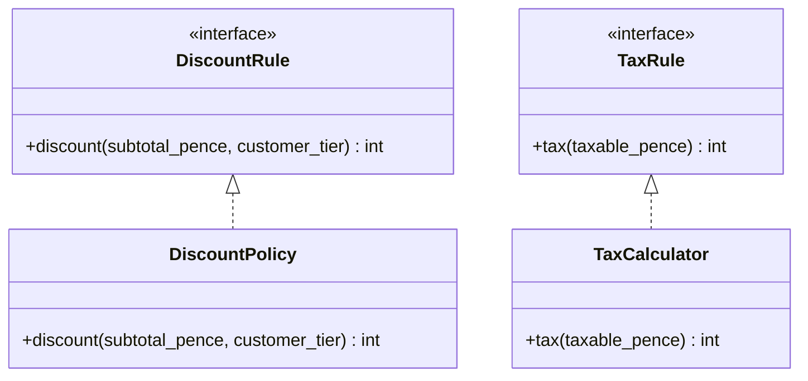
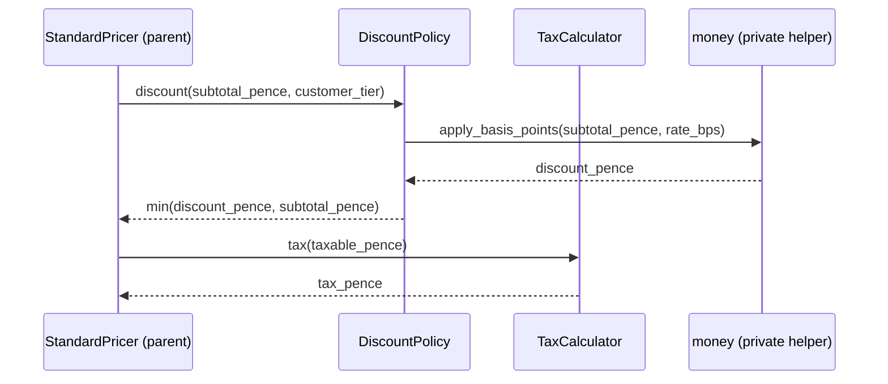

# pricing/rules

> Sub-component of `pricing`: decides the discount amount and calculates the tax.
> Not responsible for: validating orders, calculating the subtotal, assembling the price breakdown (the parent `pricing` does those).
> Why it is its own component: the parent folder uses it, and tax and discount rules may need replacing later.

## Responsibilities and data contract
- Exposes only the two interfaces `DiscountRule` and `TaxRule`, plus `default_discount_rule()` and `default_tax_rule()` (see `__init__.py`).
- All amounts are integer pence. Rounding is half up.
- Depends only on the `CustomerTier` type from `pricing.data_types`, and on nothing else in `pricing`.

| Field | `discount()` input | `tax()` input | Output | Definition |
| --- | --- | --- | --- | --- |
| `subtotal_pence` | Yes | — | — | Order subtotal (int, at least 0) |
| `customer_tier` | Yes | — | — | `"standard"` or `"vip"` |
| `taxable_pence` | — | Yes | — | Amount to tax after discount (int, at least 0) |
| return value | — | — | Yes | Discount or tax in pence (int); a discount is never more than the subtotal |

## Class diagram

## Class responsibilities
| Class | Responsible for | Not responsible for |
| --- | --- | --- |
| `DiscountRule` | <ul><li>Defines the public contract for discounts</li></ul> | Any implementation detail |
| `TaxRule` | <ul><li>Defines the public contract for tax</li></ul> | Any implementation detail |
| `DiscountPolicy` | <ul><li>Sets the base discount rate from the subtotal (uses the private helper `money` to calculate it)</li><li>Adds the vip bonus</li><li>Keeps the discount at or below the subtotal</li></ul> | Tax, validation |
| `TaxCalculator` | <ul><li>Calculates tax from the tax rate (rounded half up)</li></ul> | Discount, validation |

The two implementations are independent and do not know about each other, so replacing one does not affect the other.

## Sequence diagram

## Planned / not wired yet
- Nothing at the moment.
