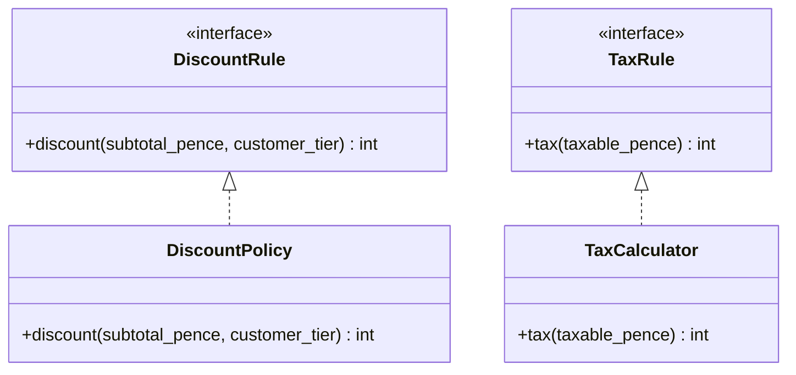
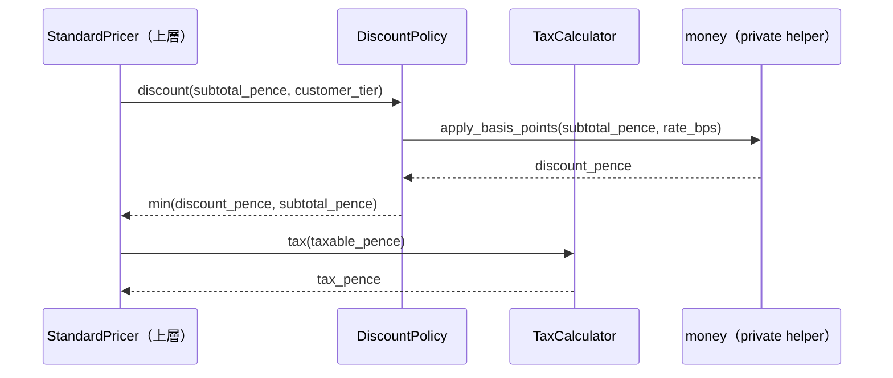

# pricing/rules

> `pricing` 嘅子元件：決定折扣金額同計算稅額。
> 唔負責：驗證訂單、計算小計、組合價格明細（由上層 `pricing` 做）。
> 獨立成元件嘅原因：被上層 folder 使用，而且稅制、折扣規則將來可能要換。

## 職責與資料契約
- 對外只提供 `DiscountRule`、`TaxRule` 兩個 interface，同 `default_discount_rule()`、`default_tax_rule()`（見 `__init__.py`）。
- 金額一律係整數便士，四捨五入用 half up。
- 只依賴 `pricing.data_types` 嘅 `CustomerTier` 型別，唔依賴 `pricing` 嘅任何其他嘢。

| 欄位 | `discount()` 輸入 | `tax()` 輸入 | 輸出 | 定義 |
| --- | --- | --- | --- | --- |
| `subtotal_pence` | Yes | — | — | 訂單小計（int，不小於 0） |
| `customer_tier` | Yes | — | — | `"standard"` 或 `"vip"` |
| `taxable_pence` | — | Yes | — | 折後要課稅嘅金額（int，不小於 0） |
| 回傳值 | — | — | Yes | 折扣或稅額，單位便士（int）；折扣不會超過小計 |

## Class diagram

## Class 職責
| Class | 職責 | 不負責 |
| --- | --- | --- |
| `DiscountRule` | <ul><li>定義折扣嘅對外契約</li></ul> | 任何實作細節 |
| `TaxRule` | <ul><li>定義稅額嘅對外契約</li></ul> | 任何實作細節 |
| `DiscountPolicy` | <ul><li>按小計定基本折扣率（用 private helper `money` 計折扣）</li><li>vip 加成</li><li>折扣不超過小計</li></ul> | 稅、驗證 |
| `TaxCalculator` | <ul><li>按稅率計稅（四捨五入，half up）</li></ul> | 折扣、驗證 |

兩個實作互相獨立，互相唔識，所以換其中一個唔會影響另一個。

## Sequence diagram

## 未接好／計劃中
- 暫時冇。
