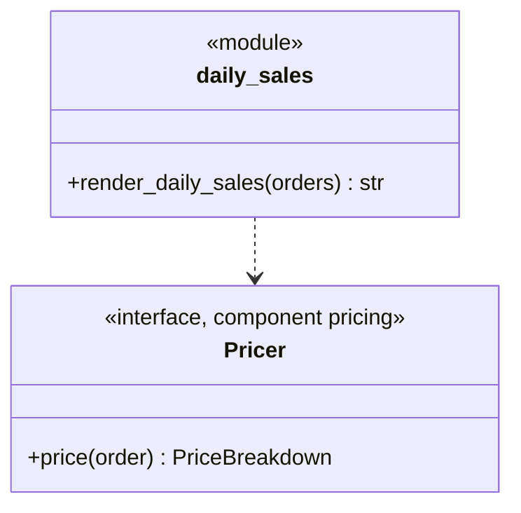
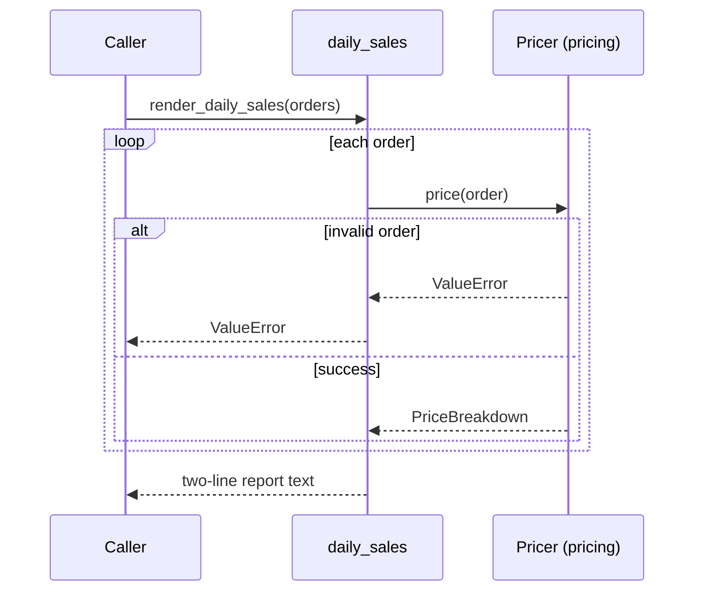

# reports

> Calculates and shows the daily sales total.
> Not responsible for: pricing (uses the `Pricer` from `pricing`), fetching orders, layout.

## Responsibilities and data contract
- Input: all of the day's orders, `list[Order]`.
- Output: two lines of text: the number of orders and the sales total (pounds, two decimal places).
- Errors: if any order is invalid, the `ValueError` from `pricing` propagates unchanged.
- Depends on `total_pence` (pence) in what `pricing` returns.

| Field | Input | Output | Definition |
| --- | --- | --- | --- |
| `orders` | Yes | — | All of the day's orders, `list[pricing.Order]` |
| `Orders` line | — | Yes | Number of orders |
| `Sales` line | — | Yes | Sum of `total_pence` over all orders, shown in pounds |

## Class diagram

## Class responsibilities
| Unit | Responsible for | Not responsible for |
| --- | --- | --- |
| `daily_sales` (module) | <ul><li>Calls `Pricer` for each order</li><li>Sums `total_pence` and formats it</li></ul> | Any pricing rule |

## Sequence diagram

## Planned / not wired yet
- Nothing at the moment.
