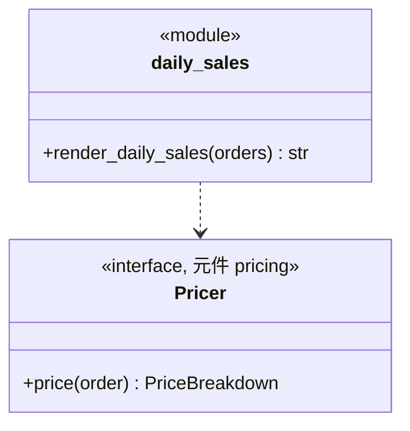
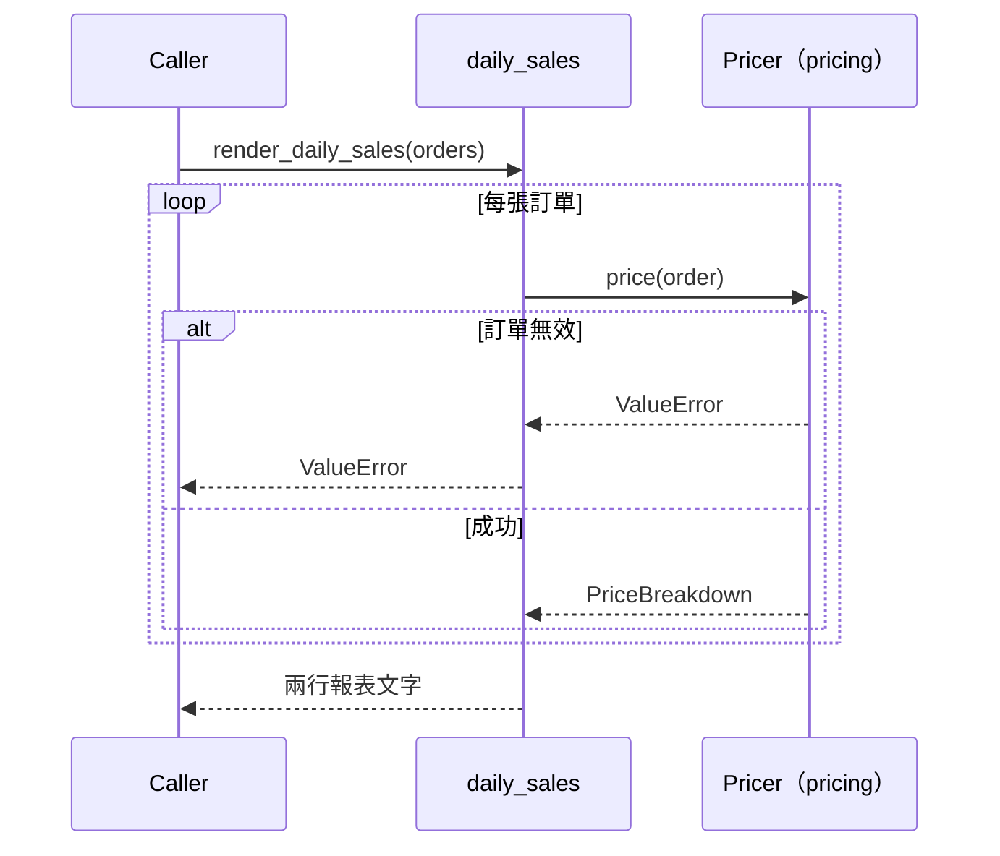

# reports

> 計算並顯示每日銷售總額。
> 唔負責：計價（用 `pricing` 嘅 `Pricer`）、取得訂單、排版。

## 職責與資料契約
- 輸入：當日所有訂單 `list[Order]`。
- 輸出：兩行文字：訂單數量、銷售總額（英鎊，兩位小數）。
- 錯誤：任何一張訂單無效，`ValueError` 由 `pricing` 直接向上拋。
- 依賴 `pricing` 輸出嘅 `total_pence`（便士）。

| 欄位 | 輸入 | 輸出 | 定義 |
| --- | --- | --- | --- |
| `orders` | Yes | — | 當日所有訂單 `list[pricing.Order]` |
| `Orders` 行 | — | Yes | 訂單數量 |
| `Sales` 行 | — | Yes | 全部訂單 `total_pence` 之和，以英鎊顯示 |

## Class diagram

## Class 職責
| 單元 | 職責 | 不負責 |
| --- | --- | --- |
| `daily_sales`（模組） | <ul><li>逐張訂單呼叫 `Pricer`</li><li>加總 `total_pence` 並格式化</li></ul> | 任何計價規則 |

## Sequence diagram

## 未接好／計劃中
- 暫時冇。
