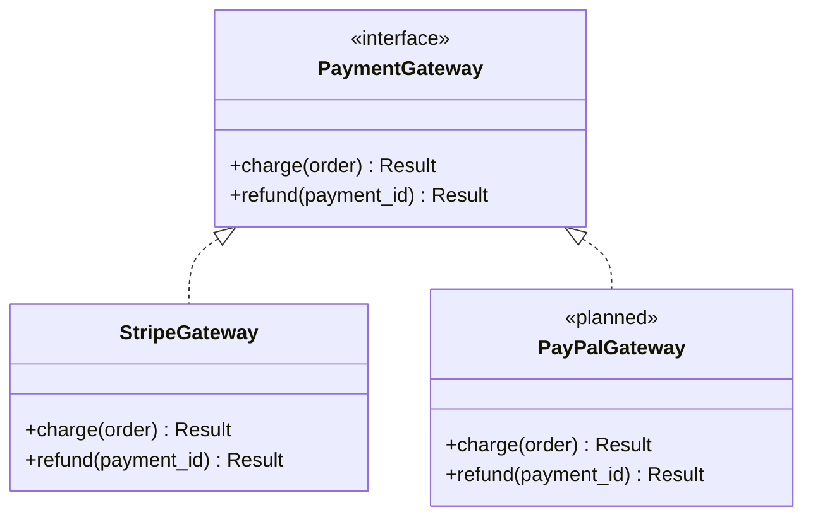
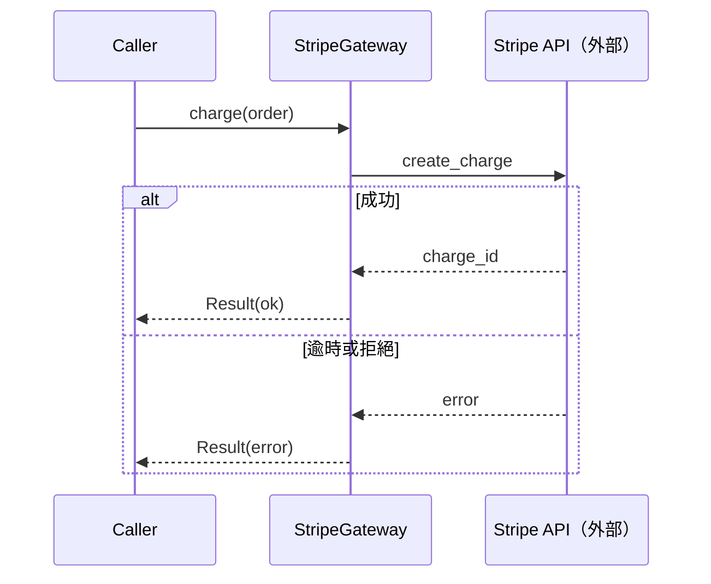

# ARCHITECTURE.md 模板同 folder 範例

## ARCHITECTURE.md 模板

````markdown
# <元件名>

> 一至三行：呢個元件做咩、唔做咩。

## 職責與資料契約
- 輸入：…
- 輸出：…
- 明確唔負責：…

| 欄位 | `param_name` | 輸出 | 定義 |
| --- | --- | --- | --- |
| `field_a` | Yes | — | 定義、單位、粒度 |

## Class diagram


## Class 職責
| Class | 職責 | 不負責 |
| --- | --- | --- |
| `StripeGateway` | <ul><li>將訂單轉成 Stripe 請求</li><li>處理 Stripe 回應同錯誤</li></ul> | 重試策略、訂單狀態 |

## Sequence diagram


## 未接好／計劃中
- [計劃] PayPalGateway 尚未實作。
````

## Folder 結構範例

```
payment/
  ARCHITECTURE.md
  payment_gateway.py      # 共用 interface
  stripe_gateway.py       # 實作
  paypal_gateway.py       # 實作（計劃中）
  _helpers/               # private，外面唔准 import
  tests/
    test_gateway_contract.py   # 行為 contract test，套用喺所有實作
```
